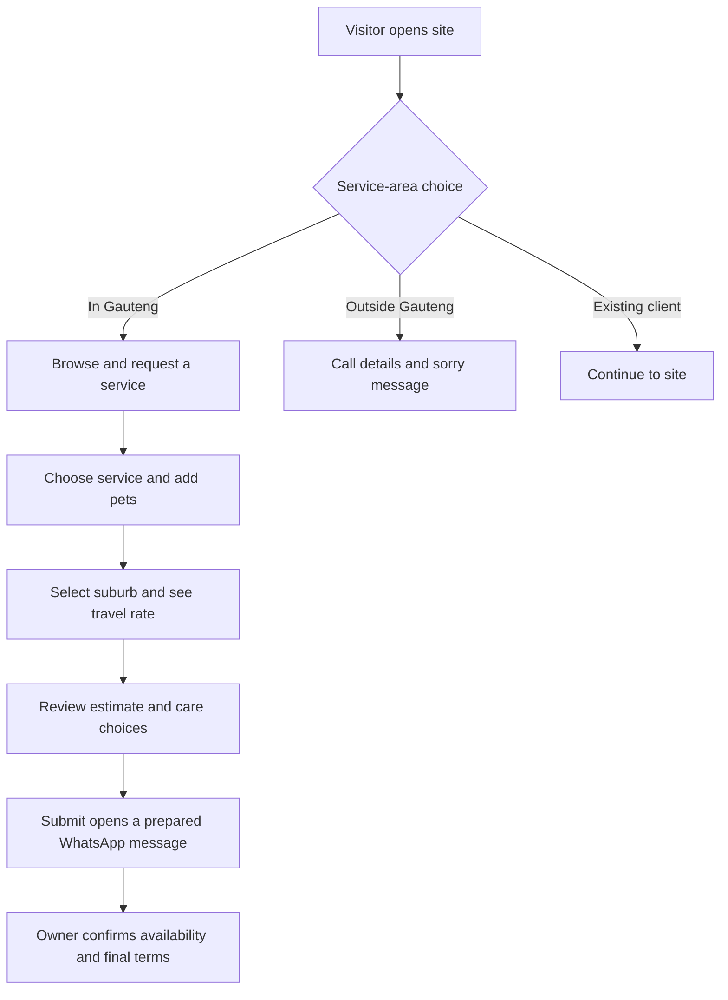
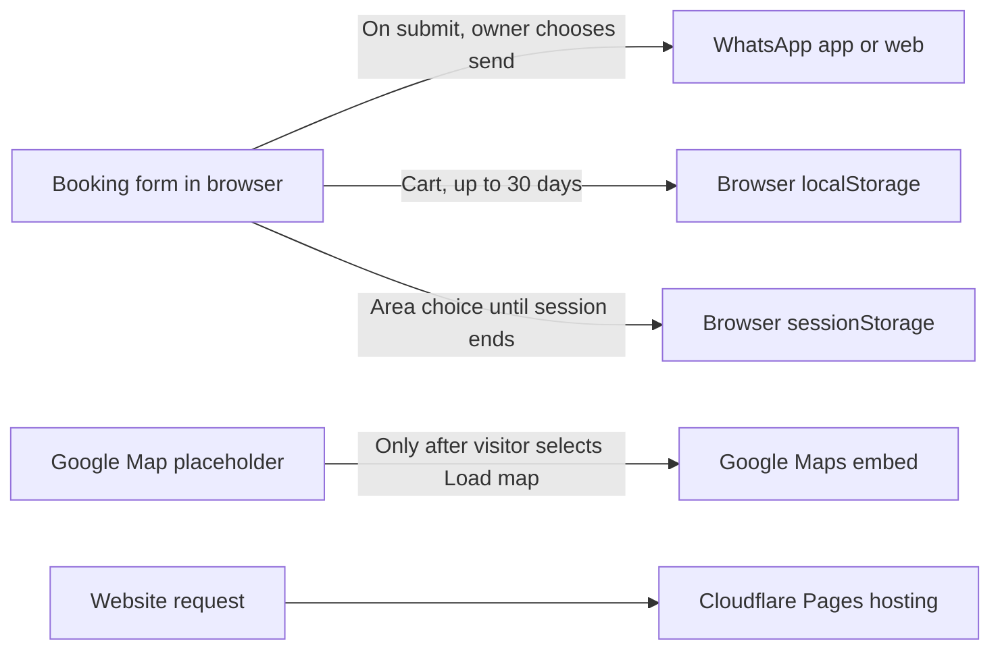

# The Pet's Butler

Centurion pet-care website for The Pet's Butler, part of Aslana Intelligence (Pty) Ltd and founded by Rudi Beukes in 1997. The project combines a responsive React/TypeScript front end with a Gauteng service-area prompt, suburb-based travel estimates, a multi-pet booking form and WhatsApp enquiries.

**Live site:** [thepetsbutler.com](https://thepetsbutler.com) · **Stack:** Vite, React, TypeScript, React Router, Cloudflare Pages

The site can be installed as a Progressive Web App (PWA). On the home page, visitors see one optional install explainer with device-specific steps. The choice to dismiss or confirm installation is remembered in browser storage; installed standalone sessions suppress the explainer. The web app manifest supplies 192px, 512px and Apple touch icons. A service worker caches the app shell and same-origin files for previously visited pages, with a small offline contact page as a fallback.

## Project showcase

### Visitor and booking flow



The area prompt is a **self-selected service-area gate** stored in `sessionStorage` for the current browser session. It does not inspect a visitor's IP address or verify their province; people outside Gauteng can still continue using the existing-client option. Service eligibility is confirmed with the owner. Describe it as a service-area flow in a portfolio, not as verified geolocation or a security boundary.

### Local travel estimate

Dog-walking and house-visit estimates use the suburb table in `src/data/suburbRates.ts`. Each listed suburb maps to a flat per-visit estimate (R100–R150), intended to account for travel from Rooihuiskraal. The booking page displays the selected rate and includes it in the prepared WhatsApp request. The rate is an estimate for listed areas, not live routing or a fuel-price calculation; confirm unlisted destinations with the owner.

### Privacy-aware third-party flow



The form does not post booking details to an application server or database. Submission opens WhatsApp with a prefilled message; the visitor can review or cancel before sending. WhatsApp/Meta handles any message after it is sent. The optional map makes a Google request only after the visitor chooses to load it. Web fonts are system-local. The app does not intentionally set analytics or advertising cookies.

### Photos, video and charts

The gallery currently displays locally stored image assets from `public/photos/`. The website does not host video uploads or an embedded video player. Any care updates promised for an accepted booking are arranged directly with that client; confirm the agreed channel and sharing preferences before sending photos or video. No customer media is uploaded to this repository by the booking flow.

Client pet photos are used in the public gallery only with the owner's permission. The business requests permission separately through WhatsApp before using a pet photo or video on the website or in marketing; care updates are not repurposed for promotion by default.

Suburb prices are presented as a selectable list and a calculated estimate, not as a chart. The Mermaid diagrams above document the actual visitor and data paths. There is no analytics dashboard or customer-data graph in the current application.

## Pages

- `/` — business story, service overview, gallery preview and contact/map area
- `/booking` — service request, multiple pets, suburb travel estimate and care options
- `/shop` — shop reconstruction notice
- `/cart` — saved cart review and WhatsApp enquiry
- `/gallery` — local image gallery and lightbox
- `/privacy` — browser storage, booking data and third-party service notice
- `/refunds` — cancellation and refund information
- PWA — optional home-screen install and offline fallback

Dog walking and overnight stays are marked fully booked. Day pet-sitting is for puppies and small-breed dogs only. Online payments are not enabled; the payment button currently explains that online payment is coming soon.

## Run locally

```bash
npm install
npm run dev
```

## Build and checks

```bash
npm run typecheck
npm run build
```

## Deployment

Cloudflare Pages serves the static Vite build from `dist/`. SPA redirects live in `public/_redirects`, and basic response headers live in `public/_headers`. Configure the GitHub repository with build command `npm run build`, output directory `dist`, and Node version from `.nvmrc`.

## Source map

| Path | Responsibility |
|---|---|
| `src/pages/` | Route pages, policy pages and booking interaction |
| `src/components/ServiceAreaGate.tsx` | Visitor-selected Gauteng/client area prompt |
| `src/data/suburbRates.ts` | Per-suburb travel estimates from Rooihuiskraal |
| `src/context/CartContext.tsx` | Cart state and 30-day browser storage |
| `src/data/business.ts` | Business contact details and opening hours |
| `public/photos/` | Gallery and site photography |
| `public/manifest.webmanifest`, `public/sw.js`, `public/offline.html` | Installable app metadata, service worker caching and offline fallback |
| `public/icons/`, `public/apple-touch-icon.png` | App launcher and Apple Home Screen icons |
| `public/llms.txt`, `public/sitemap.xml` | Search and assistant discovery files |

## Portfolio notes

Suggested honest CV summary: “Built and documented an installable React and TypeScript pet-care PWA with a multi-pet booking flow, suburb-based travel estimates, WhatsApp hand-off, session-scoped service-area prompt, offline contact fallback, privacy-aware optional map loading, and accessible gallery.” The service-area screen is not an IP geolocation system. There is no embedded video platform, chart dashboard, online payment processing, or server-side booking database in this version.
